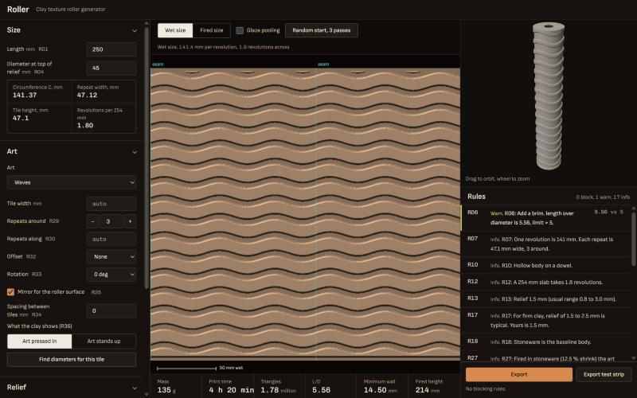

# Texture Roller

Make 3D-printable texture rollers for clay. You load a pattern or your own SVG/PNG, and the tool wraps it onto a cylinder sized for one revolution, checks it against 73 rules drawn from potters, tool makers and roller designers, and exports a watertight STL/3MF ready for the slicer.

**Use it: https://swiftblocker.github.io/texture-roller/**

It runs entirely in your browser. There is no account and no install, and nothing is uploaded. The first visit downloads the Python engine once (about 60 MB). After that it works offline.



## What it does

- **Art in:** pick a built-in seamless pattern, or load an SVG (paths are cleaned up) or a PNG/JPG (auto-traced).
- **Sized for one revolution:** circumference = pi x diameter. The repeat width and the revolutions per 10 in slab update as you type. "Find diameters for this tile" suggests diameters that fit your art a whole number of times.
- **Repeats:** around and along the roller, half-drop or brick offset, rotation, spacing, mirror, and "art pressed in" vs "art stands up".
- **Relief:** depth, draft angle and edge rounding. The draft is a real measured slope, so the clay releases.
- **Seam:** tiled art, the seam placed in blank space, a blend, or a plain gutter. Optional alignment ticks for long slabs.
- **Core:** a through bore for a dowel or rod (enter your dowel's measured diameter), end bands and chamfers, and an optional split into two halves for long rollers.
- **Clay preview:** the slab as the clay will look, at wet or fired size for your clay body, with glaze-pool shading and a random start per pass.
- **Rule checks:** every warning names its rule number. Rules that would ruin a print block the export (see `skill/pottery-roller/SKILL.md`).
- **Export:** STL, 3MF, a 16-bit heightmap PNG (for carving a flat texture board on a CNC router), a slab preview image, and a sheet with print settings and how to use the roller.
- **Test strip:** a 40 mm roller with five depth bands (0.8 to 2.5 mm). Roll it once in your clay to find the depth you like before printing a full roller.

## Printing

Print upright (roller axis vertical) with no supports, 0.12 to 0.16 mm layers, 3 walls, 15% gyroid infill, in PLA or PETG. Add a brim when the roller is more than 5 times as long as it is wide. Dust the roller lightly with cornstarch before rolling. Each export includes `sheet.md` with the details.

The depth, draft and release rules are the least certain ones (no published source measures impression depth by clay body), which is why the test strip exists. Print the test strip first.

## Run it locally (optional)

Requires Python 3.11+.

```
pip install -r requirements.txt
python -m uvicorn server:app --app-dir app --host 127.0.0.1 --port 8790
```

Open http://127.0.0.1:8790. The local server adds STEP export of the blank body, which needs `build123d`. Install it separately if you want that.

Run the tests with `python -m pytest app/tests`.

## How it is built

- `app/engine/`: the Python engine (numpy, scipy, scikit-image, svgelements, potracer, trimesh). The same code runs in the browser through Pyodide and on the desktop.
- `app/web/`: the page, a Web Worker that runs the engine, three.js for the 3D view.
- `skill/pottery-roller/SKILL.md`: the 73 rules, each with a value, the reason, the sources and a confidence. `references/checks.json` holds the thresholds the engine enforces.
- `research/`: the source notes the rules cite, an index with trust ratings, and topic summaries.
- `decisions.md`: why things are the way they are.
- `docs/`: the built site that GitHub Pages serves. Rebuild it with `python tools/build_site.py`.

## License

MIT. See `LICENSE`.
